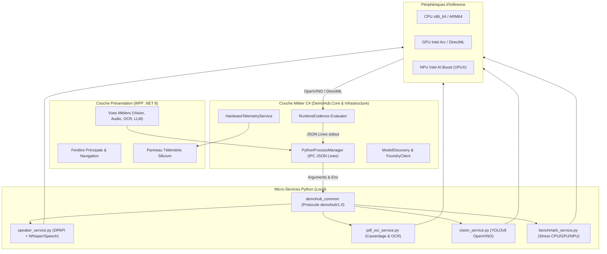

# Architecture Technique - CopilotPlusDemoHub

Ce document décrit l'organisation globale du démonstrateur technique **CopilotPlusDemoHub**, conçu pour valider les capacités de calcul hybride (CPU, GPU intégré, NPU Intel AI Boost) sous Windows 11.

## 1. Vue d'ensemble

L'application associe une interface utilisateur native en .NET 8 (WPF) à des micro-services locaux en Python.

## 2. Protocole de Communication (IPC)

La communication entre le runtime hôte C# et les exécutables Python est standardisée sous la forme d'un flux JSON Lines (`demohub/1.0`) :

- **Canal stdout** : Exclusivement réservé aux messages d'état structurés (`ready`, `progress`, `result`, `error`).
- **Canal stderr** : Réservé aux journaux d'exécution non structurés et aux diagnostics internes.
- **Cycle de vie** : Lancement avec passage d'arguments strict par tableau, gestion d'expiration (timeout) configurable, et terminaison récursive de l'arborescence des processus enfants en cas d'annulation.

## 3. Preuve d'Exécution Matérielle (RuntimeEvidence)

Pour éliminer toute ambiguïté quant à l'accélérateur actif, chaque service Python transmet un contrat `RuntimeEvidence` incluant :
- Le runtime utilisé (ex: OpenVINO, DirectML).
- L'accélérateur requis vs l'accélérateur réellement alloué.
- L'indicateur formel d'activation de repli (`fallback_used`).
- Les temps mesurés de compilation, préchauffage et inférence pure.

## 4. Sécurité Locale et Données

- **Zéro dépendance cloud obligatoire** pour l'inférence opérationnelle une fois les poids de modèles présents.
- **Protection cryptographique** des empreintes vocales via l'API Windows Data Protection (DPAPI), scellées au contexte de la session utilisateur locale.
- **Caviardage documentaire irréversible** : suppression destructive des coordonnées et des flux binaires dans les fichiers PDF cibles.
