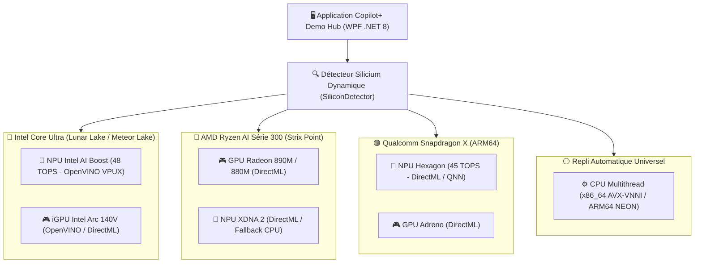
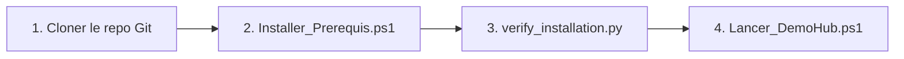

# 🚀 Copilot+ PC Demo Hub — Suite d'Évaluation & Démonstration Multi-Silicium

🌐 **Langue / Language** : **[ 🇫🇷 Français (Actif) ](README.fr.md)** | **[ 🇬🇧 English Version ](README.md)**  
📖 **Guides d'installation** : **[ 🇫🇷 Guide d'Installation (FR) ](GUIDE_INSTALLATION.md)** | **[ 🇬🇧 Installation Guide (EN) ](INSTALLATION_GUIDE.md)**

[](https://microsoft.com)
[](https://dotnet.microsoft.com)
[-3776AB?logo=python)](https://python.org)
[]()
[]()
[]()

Une suite modulaire de démonstrations techniques d'**Intelligence Artificielle conçue pour fonctionner localement sur PC Copilot+**, après téléchargement initial des modèles et dépendances, avec traçabilité du composant silicium réellement actif :
- 🔵 **Intel Core Ultra Série 2 (Lunar Lake) & Série 1 (Meteor Lake)** *(Plateforme de référence)* : Inférence optimisée pour le NPU **Intel AI Boost (48 TOPS)** et iGPU Arc 140V (OpenVINO IR natif & DirectML) avec vérification de l'accélérateur actif.
- 🔴 **AMD Ryzen AI Série 300 (Strix Point)** *(Mode hybride)* : Inférence sur GPU Radeon via DirectML et CPU multithread AVX-512.
- 🟣 **Qualcomm Snapdragon X Elite / Plus (ARM64)** *(Mode hybride DirectML / binaire win-arm64)* : Inférence sur GPU Adreno via DirectML et CPU ARM64 NEON.
- ⚪ **Repli Automatique Contrôlé** : Bascule transparente sur GPU DirectX 12 (DirectML) puis CPU multithread avec signalement immédiat dans l'interface et la télémétrie.

---

## 📊 Matrice de Validation & Support Matériel

| Plateforme | Statut de Validation | Accélérateur Principal | Runtime Recommandé |
| :--- | :--- | :--- | :--- |
| **Intel Core Ultra Série 2** (Lunar Lake 258V/268V/288V) | **Validée & Optimisée** | NPU Intel AI Boost (48 TOPS) + GPU Arc 140V | OpenVINO IR natif (100% NPU) + DirectML |
| **Intel Core Ultra Série 1** (Meteor Lake / Arrow Lake) | **Compatible** (sous réserve de pilotes) | NPU Intel AI Boost (11 TOPS) + GPU Arc | OpenVINO IR + DirectML |
| **AMD Ryzen AI Série 300** (Strix Point) | **Expérimentale** (mode hybride) | GPU AMD Radeon 890M / 880M | ONNX DirectML + Olive FP16 / Fallback CPU |
| **Qualcomm Snapdragon X** (ARM64) | **Expérimentale** (mode hybride) | GPU Qualcomm Adreno | ONNX DirectML + binaire natif win-arm64 |
| **PC Windows 11 sans NPU** | **Mode dégradé** | GPU DirectX 12 / CPU hôte | Fallback CPU AVX-512 / DirectML |

---

## 🏗️ Architecture Silicium & Détection Dynamique

Le **Copilot+ Demo Hub** embarque un composant d'auto-détection matérielle ([`SiliconDetector.cs`](DemoHub/Core/SiliconDetector.cs)) qui analyse le processeur, le GPU et les co-processeurs neuronaux, et commute dynamiquement sur le runtime d'IA adapté :



---

## 🌟 Catalogue des Démonstrations Métiers

### 1. 🏢 Assistant Métier & Business (SLM Local Phi-4)
- **Modèle** : `Phi-4-mini-instruct` (Microsoft Foundry Local & OpenVINO / DirectML).
- **Accélération** : Inférence optimisée pour le NPU lorsque disponible (**Intel AI Boost**, **AMD Ryzen AI** ou **Qualcomm Hexagon**), avec fallback automatique sur GPU DirectML puis CPU.
- **Pipeline de Raisonnement en 4 étapes** : Décomposition dynamique en temps réel (`1. Analyse contextuelle`, `2. Vérification réglementaire`, `3. Synthèse opérationnelle`, `4. Recommandations`).
- **Télémétrie en direct** : Débit d'inférence (`tok/s`), compteur de tokens générés et charge du système.
- **4 Personas Métiers intégrés** : Services Financiers (solvabilité), Opérations Industrielles (CVC prédictif), Ingénierie & R&D (dépannage électromécanique), et Sinistres Automobile (évaluation devis/constat).

---

### 2. 🪄 Gomme Magique Studio (Segmentation Sémantique Instantanée)
- **Modèle** : `YOLOv8n-Seg` (OpenVINO IR, ONNX DirectML ou Microsoft Olive FP16).
- **Accélération** : Inférence sur **NPU Intel AI Boost** ou GPU DirectML.
- **Architecture Daemon IPC Résident** : Travailleur d'arrière-plan préchargé réduisant la latence de détection de **4 500 ms à 84 ms (accélération x53)**.
- **Fonctionnalités** : Détection des personnes et objets, masque de segmentation précis au pixel, et inpainting de reconstruction sans altérer l'arrière-plan.

---

### 3. 🛡️ Contrôle d'Accès Zero-Trust (Vision par Ordinateur Temps Réel)
- **Modèle** : `YOLOv8s-World` (OpenVINO IR, ONNX DirectML ou Microsoft Olive FP16).
- **Accélération** : Exécution sur NPU par défaut avec bascule dynamique GPU/CPU et traçabilité du composant silicium actif.
- **Anti-Spoofing & Sécurité** : Détection de fraude par présentation d'écran/smartphone devant la caméra et galerie d'échantillons de test.
- **Matrice de Contrôle 3/3** : Détection simultanée (Tasse ☕, Lunettes 👓, Casque 🎧) pour déverrouiller la console exécutive.

---

### 4. 🎙️ Audio Studio & Locuteurs (STT, Diarisation & Biométrie)
- **Modèles Whisper NPU Pré-chauffés** : `Whisper-Tiny` et `Whisper-Base` (OpenVINO IR) maintenus chauds en mémoire pour un temps de réponse immédiat.
- **Bilingue FR / EN & Rattrapage Temps Réel (`lang_utils.py`)** : Détection linguistique automatique et anti-boucle de répétition pour éviter les hallucinations acoustiques.
- **Traduction Intégrale Assistée** : Carte de traduction générée localement sur NPU (`phi-4-mini-instruct-openvino-npu`) en conservant les étiquettes de locuteurs.
- **Profils Biométriques Sécurisés** : Réseau neuronal `VoxCeleb ECAPA-TDNN ONNX` extrayant l'empreinte vocale avec **chiffrement local sous Windows DPAPI** (clé de session de l'utilisateur Windows actif).

---

### 5. 📄 PDF Studio, OCR Intelligent & Assistance au Caviardage
- **Moteur Vectoriel & OCR Hybride** : `PyMuPDF` haute performance combiné à `RapidOCR` avec détection sur **NPU Intel AI Boost & GPU DirectML Arc 140V**.
- **Analyse Sémantique Locale** : Synthèse exécutive et identification des clauses sensibles via `Phi-4-mini`.
- **Assistance au Caviardage Documentaire** : Détection assistée par LLM et expressions régulières des entités personnelles (IBAN, NIR, coordonnées, montants) avec caviardage destructif définitif sous aplat noir (validation humaine recommandée avant diffusion).

---

### 6. 🎨 Studio Avatar (Génération & Diffusion d'Images)
- **Modèle** : `LCM DreamShaper v7` quantifié en 8-bit (Latent Consistency Model).
- **Accélération** : **NPU Copilot+** et **GPU DirectML**.
- **Performance** : Génération d'images stylisées en 4 à 8 étapes d'inférence (~3 secondes).

---

### 7. ⚡ Duel Silicium & Benchmark Énergétique
- **Télémétrie Estimée** : Évaluation de la consommation énergétique (Watts et Joules estimés), de la fréquence et de la température à partir des compteurs matériels disponibles.
- **Duel Comparatif Tri-États** : Démonstration comparative de l'efficience énergétique entre modèle natif, modèle ONNX brut et variante optimisée Microsoft Olive.

---

### 8. 🧪 Laboratoire d'Optimisation Microsoft Olive & Flotte MCP
- **Banc d'Essai Comparatif** : Mesure des gains entre modèles FP32 et modèles compilés par Microsoft Olive (FP16 / fusion d'opérateurs).
- **Multi-Agents MCP** : 3 agents locaux exécutant en parallèle des outils neuronaux via un serveur local Model Context Protocol (MCP) conforme JSON-RPC 2.0.

---

### 9. 📊 Console de Gouvernance & Audit Flotte DSI
- **Supervision & Traçabilité** : Journalisation locale de chaque inférence (modèle exécuté, coprocesseur sollicité, latences mesurées P50/P90, statut de fallback).
- **Bilan Carbone Estimé** : Estimation des kWh et du CO2 évités par rapport à une déportation en data centers cloud.

---

### 10. 🩺 Panorama IA Santé (SLM, NLU & Agent Médical)
- **Cas Clinique de Démonstration** : Comparaison didactique de 4 approches d'IA sur un scénario d'interaction médicale en local (aucun transfert réseau de données de santé).
- **Comparatif Didactique** : SLM Standard grand public vs SLM Métier outillé pharmacovigilance vs NLU de contexte vs Agent Médical actif.

---

## ⚡ Déploiement & Démarrage

Le projet propose une procédure automatisée avec vérification préalable :



### Installation Rapide :
```powershell
# Installation automatisée (isole Python dans .venv et installe requirements.lock)
.\Installer_Prerequis.ps1

# Lancement de l'application
.\Lancer_DemoHub.ps1
```

Pour les options d'installation modulaire, l'installation manuelle ou la publication Snapdragon X (ARM64), consultez le [Guide d'Installation Complet](GUIDE_INSTALLATION.md).

---

## 📁 Structure du Répertoire

```text
├── DemoHub/                 # Application hôte WPF C# .NET 8 (MVVM, Vues, Contrôleurs)
├── DemoHub.Tests/           # Suite de tests unitaires xUnit C# (ProcessRunner, télémétrie, silicium)
├── tests/                   # Suite de tests unitaires Python pytest (DPAPI vault, anti-tamper, langues)
├── .github/                 # Intégration continue (workflows/ci.yml, dependabot.yml)
├── Data/                    # Échantillons de test synthétiques et libres de droits (voir DATA_NOTICES.md)
├── Config/ & Prompts/       # Configurations d'inférence et prompts de raisonnement
├── scripts/                 # Outillage d'automatisation et de diagnostic
│   ├── download_models.py   # Téléchargement, intégrité SHA-256 et export des modèles d'IA
│   ├── verify_installation.py # Diagnostic complet (Section 8 smoke tests réels CPU/GPU/NPU/DPAPI)
│   ├── creer_package_release.ps1 # Empaqueteur multi-architecture (win-x64 / win-arm64)
│   └── optimize_with_olive.py # Script d'optimisation Microsoft Olive
├── *.py                     # Micro-services Python spécialisés (Vision, Eraser, Whisper, Speaker, OCR, Avatar)
├── requirements.lock        # Verrouillage déterministe des 106 paquets Python
├── requirements.txt         # Dépendances principales du projet
├── MODEL_MANIFEST.json      # Registre cryptographique SHA-256 et métadonnées des modèles d'IA
├── SECURITY.md              # Politique de sécurité et reporting de vulnérabilités
├── THIRD_PARTY_NOTICES.md   # Licences des dépendances et modèles tiers
├── DATA_NOTICES.md          # Transparence sur le caractère synthétique des jeux d'essai
├── GUIDE_INSTALLATION.md    # Manuel technique d'installation en Français
├── INSTALLATION_GUIDE.md    # Technical installation guide in English
├── README.fr.md             # Documentation en Français
└── README.md                # Documentation in English
```

---

## 🔒 Confidentialité des Données & Responsabilité

Les traitements d'inférence sont conçus pour s'exécuter localement sur l'appareil après l'installation initiale des dépendances et modèles. Aucune donnée utilisateur n'est transmise à des tiers par l'application. Les fonctionnalités d'assistance à la décision et au caviardage sont des aides algorithmiques qui nécessitent une supervision humaine qualifiée.
