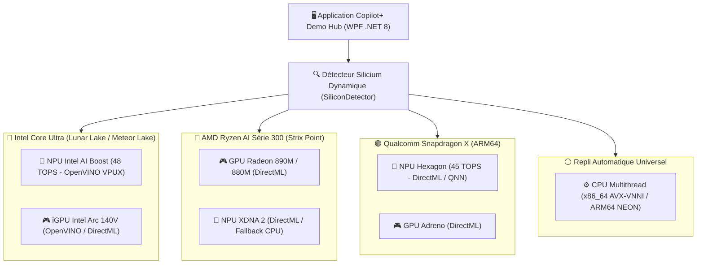
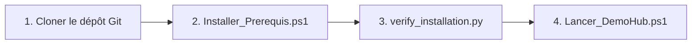

# 🚀 Copilot+ PC Demo Hub — Suite d'Évaluation & Démonstration Multi-Silicium

🌐 **Langue / Language** : **[ 🇫🇷 Français (Actif) ](README.fr.md)** | **[ 🇬🇧 English Version ](README.md)**  
📖 **Guides d'installation** : **[ 🇫🇷 Guide d'Installation (FR) ](GUIDE_INSTALLATION.md)** | **[ 🇬🇧 Installation Guide (EN) ](INSTALLATION_GUIDE.md)**

[](https://microsoft.com)
[](https://dotnet.microsoft.com)
[-3776AB?logo=python)](https://python.org)
[]()
[](.github/workflows/ci.yml)
[](DemoHub.Tests/)
[](tests/)
[](.github/workflows/codeql.yml)
[](requirements.lock)
[](MODEL_MANIFEST.json)
[](SBOM.spdx.json)

**Copilot+ Demo Hub** est un démonstrateur technique avancé et structuré conçu pour **l'exécution d'IA locale à 100% sur PC Copilot+ sous Windows 11** (après téléchargement initial des modèles et dépendances). Il offre une observabilité complète de l'accélération matérielle, des latences et de l'efficacité énergétique à travers les processeurs neuronaux hétérogènes (NPU, GPU et CPU).

> [!IMPORTANT]
> **Périmètre du Projet & Transparence** : Ce projet est un démonstrateur d'évaluation technique. Une frontière stricte sépare :
> - **Les mesures physiques réelles** : Latences d'inférence (P50/P90), puissance de décharge batterie ACPI réelle, et intégrité cryptographique SHA-256 des modèles.
> - **Les démonstrations pédagogiques** : Scénarios didactiques scénarisés (duels SLM, conformité visuelle des périphériques) clairement étiquetés afin d'éviter toute injection de données fictives dans les journaux de télémétrie.

---

## 📊 Matrice de Validation & Support Matériel

| Plateforme | Statut de Validation | Accélérateur Principal | Runtime Recommandé |
| :--- | :--- | :--- | :--- |
| **Intel Core Ultra Série 2** (Lunar Lake 258V/268V/288V) | **Validée & Optimisée** *(Référence)* | NPU Intel AI Boost (48 TOPS) + GPU Arc 140V | OpenVINO IR validé sur NPU Intel + DirectML |
| **Intel Core Ultra Série 1** (Meteor Lake 155H/165H) | **Compatible** (sous réserve de pilotes) | NPU Intel AI Boost (11 TOPS) + GPU Arc | OpenVINO IR + DirectML |
| **Intel Core Ultra 200S / Arrow Lake** | **Compatible CPU/GPU** | GPU Intel Arc / CPU hôte | DirectML + OpenVINO CPU |
| **AMD Ryzen AI Série 300** (Strix Point) | **Expérimentale** (mode hybride) | GPU AMD Radeon 890M / 880M | ONNX DirectML + Olive FP16 / Fallback CPU |
| **Qualcomm Snapdragon X** (ARM64) | **Expérimentale** (mode hybride) | GPU Qualcomm Adreno / NPU Hexagon | ONNX DirectML + binaire natif `win-arm64` |
| **PC Windows 11 sans NPU** | **Mode dégradé** | GPU DirectX 12 / CPU hôte | Fallback CPU AVX-512 / DirectML |

---

## 🏗️ Architecture Silicium & Détection Dynamique

Le **Copilot+ Demo Hub** embarque un composant d'auto-détection matérielle ([`SiliconDetector.cs`](DemoHub/Core/SiliconDetector.cs)) qui analyse le processeur, le GPU et les co-processeurs neuronaux pour commuter dynamiquement sur le runtime d'IA adapté :



---

## 🏆 Parcours Phares Validés (Core Validated Showcases)

Ces trois parcours utilisateur de bout en bout sont vérifiés, mesurés et exécutés sans raccourcis simulés :

### 1. 🏢 Assistant Documentaire Technique & Métier (SLM Local Phi-4)
- **Moteur d'inférence local** : Propulsé par `Phi-4-mini-instruct` via **Microsoft Foundry Local** CLI ou OpenVINO IR / DirectML. Zéro jeton ou donnée transmis hors du poste.
- **Pipeline de raisonnement en 4 étapes** : Chaîne de pensée dynamique (`1. Analyse de contexte`, `2. Contrôle réglementaire & risques`, `3. Synthèse opérationnelle`, `4. Recommandations actionnables`).
- **Télémétrie matérielle en temps réel** : Vitesse de génération réelle (`tok/s`), comptage des jetons et mémoire allouée.
- **4 Domaines Métier Réels** : Analyse de risque de crédit, Maintenance prédictive CVC, Ingénierie électromécanique, et Expertise de sinistres automobiles.
- **Streaming asynchrone résilient** : Lecture asynchrone non-bloquante avec détection et signalement explicite des réponses partielles ou interrompues.

### 2. 🎙️ Transcription Locale & Diarisation Vocale (Whisper NPU)
- **Moteur Whisper préchauffé** : `Whisper-Tiny` et `Whisper-Base` (OpenVINO IR) préchargés en mémoire NPU/iGPU pour une réponse instantanée.
- **Filtre anti-hallucination bilingue (`lang_utils.py`)** : Détection automatique de la langue (FR/EN) et suppression des répétitions acoustiques lors des silences ou bruits de fond.
- **Biométrie vocale locale chiffrée** : Empreintes neuronales (`VoxCeleb ECAPA-TDNN ONNX`) **chiffrées localement via Windows DPAPI** liées à la session Windows de l'utilisateur.
- **Synthèse de réunion multi-locuteurs** : Synthèse de réunion générée localement par Phi-4 avec préservation des attributions des locuteurs.

### 3. 📄 OCR Neuronal & Caviardage Dynamique de Documents Sensibles
- **Pipeline OCR hybride** : Extraction ultra-rapide du texte avec `PyMuPDF` couplé à `RapidOCR` accéléré sur **NPU** et **GPU DirectML**.
- **Traitement automatique des PDF numérisés** : Détection automatique des documents scannés ou images sans couche texte native et exécution de l'OCR avant analyse.
- **Détection dynamique des PII & Caviardage destructif** : Identification combinée (regex + SLM) des données personnelles (IBAN, numéros fiscaux, téléphones, emails, montants financiers). Application de masquages vectoriels permanents et irréversibles directement dans le fichier PDF (sans liste statique de noms fictifs).

---

## 🎓 Démonstrations Pédagogiques & Scénarios Scénarisés

Ces fonctionnalités sont conçues pour l'illustration didactique et disposent d'un étiquetage explicite dans l'interface :

- **🛡️ Contrôle de Conformité Visuelle (`SecurityAccessView`)** : Vérification de la présence de périphériques webcam (lunettes, casque, badge, anti-spoofing). *Scénario pédagogique — ne protège pas d'accès opérationnel critique.*
- **🪄 Magic Eraser Studio (`YOLOv8n-Seg`)** : Segmentation sémantique et inpainting en temps réel via un démon résident en arrière-plan (latence de 84 ms).
- **🎨 Avatar Studio (`LCM DreamShaper v7`)** : Diffusion d'images quantifiée en 8 bits en 4 à 8 étapes (~3s). Mesure de la décharge batterie ACPI réelle ou mention `N/A`.
- **⚡ Duel Silicium & Laboratoire Microsoft Olive** : Banc comparatif illustrant les gains d'efficacité entre FP32, FP16 et graphes d'opérateurs fusionnés sous Olive.
- **📊 Console de Télémétrie & Gouvernance IT Locale** : Tableau de bord d'audit d'entreprise affichant les latences matérielles réelles (P50/P90), l'accélérateur actif et les gains énergétiques estimés.

---

## ⚡ Déploiement & Démarrage Rapide



### Installation Rapide :
```powershell
# Installation automatisée (configure le .venv et sélectionne le lock file de l'architecture)
.\Installer_Prerequis.ps1

# Lancer la démonstration avec accélération matérielle
.\Lancer_DemoHub.ps1
```

Pour les commutateurs modulaires (`-CheckOnly`, `-DownloadModels`, `-BuildApplication`) ou les builds Qualcomm Snapdragon X (ARM64), consultez le [Guide d'Installation](GUIDE_INSTALLATION.md).

---

## 📁 Structure du Répertoire

```text
├── DemoHub/                 # Application hôte WPF C# .NET 8 (MVVM, Vues, Contrôleurs)
├── DemoHub.Tests/           # Suite de tests unitaires xUnit C# (ProcessRunner, télémétrie, détection silicium)
├── tests/                   # Suite de tests Python pytest (coffre DPAPI, anti-altération, filtres linguistiques)
├── .github/workflows/       # Workflows CI GitHub (ci.yml, codeql.yml, dependabot.yml)
├── Data/                    # Données de test synthétiques et libres de droits (voir DATA_NOTICES.md)
├── Config/ & Prompts/       # Configurations d'inférence et prompts de raisonnement
├── demohub_common/          # Modules Python partagés (devices, evidence, process management, OCR)
├── scripts/                 # Scripts d'automatisation et de diagnostic
│   ├── download_models.py   # Téléchargement, vérification SHA-256 et export ONNX
│   ├── verify_installation.py # Diagnostic et tests d'exécution matériels
│   ├── creer_package_release.ps1 # Création de packages multi-architectures (win-x64 / win-arm64)
│   └── optimize_with_olive.py # Optimisation avec Microsoft Olive
├── requirements.lock        # Verrouillage déterministe des dépendances Python (UTF-8)
├── requirements-win-x64.lock # Dépendances verrouillées pour Windows x64 (OpenVINO + DirectML)
├── requirements-win-arm64.lock # Dépendances verrouillées pour Windows ARM64 (ONNX Runtime)
├── requirements.txt         # Dépendances déclaratives avec sélecteurs de plateforme
├── MODEL_MANIFEST.json      # Registre cryptographique SHA-256 et métadonnées des modèles
├── SECURITY.md              # Politique de sécurité et signalement des vulnérabilités
├── THIRD_PARTY_NOTICES.md   # Licences tierces open source
├── DATA_NOTICES.md          # Notice de transparence sur les données de démonstration
├── GUIDE_INSTALLATION.md    # Guide d'installation en français
├── INSTALLATION_GUIDE.md    # Guide d'installation en anglais
├── README.fr.md             # Documentation en français
└── README.md                # Documentation en anglais
```

---

## 🔒 Confidentialité & Déclaration de Gouvernance

Toutes les inférences neuronales sont conçues pour s'exécuter localement sur la machine hôte après l'installation initiale des packages et modèles. Aucune donnée utilisateur ou confidentielle n'est transmise à une infrastructure cloud tierce. Les résultats algorithmiques (aide à la décision, transcription automatique, caviardage assisté) constituent des outils d'aide nécessitant une validation humaine qualifiée.
