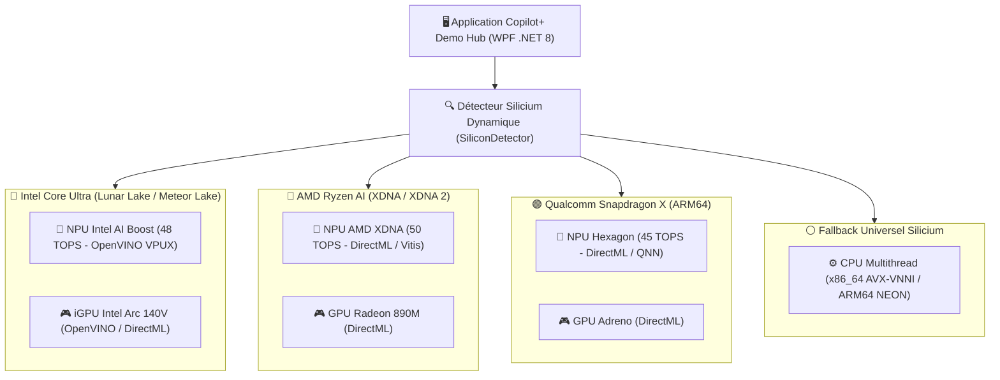
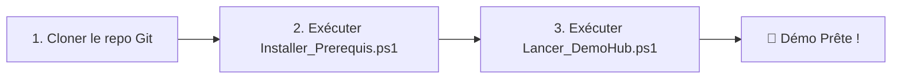

# 🚀 Copilot+ PC Demo Hub — Suite Universelle Multi-Constructeurs

[](https://microsoft.com)
[](https://dotnet.microsoft.com)
[](https://python.org)
[]()
[]()
[]()
[]()

Une suite complète d'expériences logicielles d'**Intelligence Artificielle 100% locales, privées et souveraines**, universellement compatible avec l'ensemble de l'écosystème des **PC Copilot+** :
- 🔵 **Intel Core Ultra (Lunar Lake & Meteor Lake)** via **Intel AI Boost (48 TOPS)** & iGPU Arc.
- 🔴 **AMD Ryzen AI Série 300 (Strix Point)** via **AMD XDNA 2 (50 TOPS)** & GPU Radeon.
- 🟣 **Qualcomm Snapdragon X Elite / Plus** via **Qualcomm Hexagon (45 TOPS)** & GPU Adreno.
- ⚪ **Fallback Universel Automatique** sur GPU DirectX 12 (DirectML) et CPU multithread AVX-512 / ARM64.

---

## 🏗️ Architecture Silicium Universelle & Auto-Détection

Le **Copilot+ Demo Hub** embarque un composant d'auto-détection matérielle en temps réel (`SiliconDetector.cs`) qui analyse le processeur, le GPU et les co-processeurs neuronaux, et commute dynamiquement sur le runtime d'IA le plus efficient :



---

## 🌟 Catalogue des Démonstrations Métiers

### 1. 🏢 Assistant Métier & Business (LLM Local Phi-4)
- **Modèle** : `Phi-4-mini-instruct` (Microsoft Foundry Local & OpenVINO / DirectML).
- **Accélération** : Compilé nativement pour le NPU détecté (**Intel AI Boost**, **AMD Ryzen AI** ou **Qualcomm Hexagon**), avec fallback automatique et transparent sur GPU DirectML puis CPU.
- **Pipeline de Raisonnement en 4 étapes** : Décomposition dynamique en temps réel (`1. Analyse contextuelle`, `2. Vérification réglementaire`, `3. Synthèse opérationnelle`, `4. Recommandations`).
- **Télémétrie en direct** : Chronomètre à 75ms, jauge de débit d'inférence en temps réel (`tok/s`), compteur de tokens générés et surveillance de la charge SoC.
- **4 Personas Métiers intégrés** :
  - **Services Financiers** : Audit de solvabilité et analyse de risques de crédit entreprise.
  - **Opérations Industrielles** : Diagnostic prédictif d'avarie sur groupe CVC et criticité d'intervention.
  - **Ingénierie & R&D** : Dépannage électromécanique et procédures de sécurité d'urgence.
  - **Sinistres Automobile** : Évaluation conjointe devis / constat d'accident.

---

### 2. 🪄 Gomme Magique Studio (Segmentation Sémantique Instantanée)
- **Modèle** : `YOLOv8n-Seg` (OpenVINO IR, ONNX DirectML ou Microsoft Olive FP16).
- **Accélération** : Inférence sur **NPU Copilot+ (Intel / AMD / Qualcomm)** ou GPU DirectML.
- **Architecture Daemon IPC Résident** : Travailleur d'arrière-plan préchargé réduisant la latence de détection de **4 500 ms à seulement 84 ms (accélération x53)**.
- **Fonctionnalités** : Détection automatique des personnes et objets gênants, masque de segmentation précis au pixel près, et inpainting haute fidélité sans altérer le fond.

---

### 3. 🛡️ Contrôle d'Accès Zero-Trust (Vision par Ordinateur Temps Réel & Démineur)
- **Modèle** : `YOLOv8s-World` (OpenVINO IR, ONNX DirectML ou Microsoft Olive FP16).
- **Accélération** : Pipeline hybride **NPU / GPU DirectML**.
- **Flux Vidéo** : Capture webcam fluide à 30 IPS.
- **Matrice de Conformité de Sécurité** : Détection simultanée 3/3 (Tasse ☕, Lunettes 👓, Casque 🎧) pour déverrouiller la console exécutive et dévoiler le jeu de Démineur souverain.

---

### 4. 🎙️ Audio Studio & Locuteurs (STT & Biométrie Vocale)
- **Transcription** : Modèles `Whisper-Tiny` et `Whisper-Base` quantifiés FP16 pour une retranscription vocale ultra-rapide en français et en anglais.
- **Biométrie du Locuteur** : Réseau neuronal profond `VoxCeleb ECAPA-TDNN ONNX` extrayant l'empreinte acoustique unique de chaque participant.
- **Sécurité TPM 2.0** : Scellement cryptographique des profils biométriques dans le matériel Windows via DPAPI / TPM.

---

### 5. 📄 PDF Studio & OCR Intelligent
- **Moteur Vectoriel** : `PyMuPDF` haute performance pour l'extraction de texte et la manipulation de structures PDF.
- **OCR Neuronal Hybride** : `RapidOCR` accéléré par **NPU / GPU DirectML** pour les scans et documents numérisés dégradés.
- **Anonymisation & Conformité RGPD** : Détection et caviardage automatique des données sensibles (IBAN, numéros de sécurité sociale, noms, montants).

---

### 6. 🎨 Studio Avatar (Génération & Diffusion d'Images)
- **Modèle** : `LCM DreamShaper v7` quantifié en 8-bit (Latent Consistency Model).
- **Accélération** : **NPU Copilot+** et **GPU DirectML**.
- **Performance** : Génération d'images photoréalistes et stylisées (Pixar 3D, Cyberpunk, Années 60) en seulement 4 à 8 étapes d'inférence (~3 secondes).

---

### 7. ⚡ Duel Silicium & Benchmark Énergétique Hardware
- **Télémétrie Matérielle** : Mesure en temps réel de la consommation énergétique (Watts), de la fréquence et de la température.
- **Duel Comparatif Tri-États** : Démonstration visuelle de l'efficience énergétique du **NPU Copilot+ (40 à 50+ TOPS)** confrontant le modèle natif, le modèle brut ONNX et la variante optimisée Microsoft Olive.

---

### 8. 🧪 Laboratoire d'Optimisation Microsoft Olive & Trio Multi-Agents MCP
- **Banc d'Essai Scientifique** : Duel comparatif en temps réel entre modèles bruts FP32 et modèles compilés par Microsoft Olive (FP16 / fusion de graphe) sur la Vision, la Segmentation et l'OCR.
- **Gains Mesurés en Direct** : Division par deux de l'empreinte mémoire (-50% RAM et SSD), accélération de la latence (+40% à +80%) et réduction de la dépense énergétique en Joules avec 100% de fidélité conservée.
- **Flotte Multi-Agents MCP** : 3 agents autonomes exécutant en parallèle des outils neuronaux via un serveur local Model Context Protocol (MCP) conforme JSON-RPC 2.0.

---

### 9. 📊 Console de Gouvernance & Audit Flotte DSI
- **Supervision d'Entreprise** : Tableau de bord centralisé pour les directeurs informatiques (DSI) et responsables sécurité (RSSI).
- **Traçabilité & Conformité** : Journalisation locale de chaque inférence (modèle exécuté, coprocesseur sollicité, latences P50/P90, statut Zero-Trust).
- **Bilan Carbone & Green IT** : Calcul automatisé des kWh économisés et des émissions de CO2 évitées par rapport à un traitement distant en data centers hyperscalers.

---

## ⚡ Guide Pas à Pas pour vos Collègues

Le projet est conçu pour être déployé en **1 clic sans aucune configuration manuelle**.



### Étape 1 : Cloner le dépôt Git
Ouvrez un terminal **PowerShell** :
```powershell
git clone https://github.com/JuGhithub/CopilotPlusDemoHub.git
cd CopilotPlusDemoHub
```

### Étape 2 : Lancer l'Installateur Automatique
Dans PowerShell, lancez simplement :
```powershell
.\Installer_Prerequis.ps1
```
*(Ou double-cliquez sur `Installer_Prerequis.bat` depuis l'Explorateur Windows)*

Le script prend tout en charge automatiquement et séquentiellement :
1. ✅ **Activation des chemins longs Windows** (`LongPathsEnabled`) pour PyTorch et OpenVINO.
2. ✅ **Installation des socles système** : SDK **.NET 8.0** et **Python 3.12** via `winget`.
3. ✅ **Installation des bibliothèques Python d'IA** listées dans `requirements.txt`.
4. ✅ **Installation de Microsoft Foundry Local CLI** et téléchargement des modèles **Phi-4-mini** (NPU, GPU, CPU).
5. ✅ **Téléchargement automatique de 100% des modèles d'IA locaux** (`models/`) via [`scripts/download_models.py`](scripts/download_models.py) : Whisper Tiny/Base, Biométrie VoxCeleb, Vision YOLOv8s-World, Segmentation YOLOv8n-Seg et Studio Avatar LCM.
6. ✅ **Compilation de l'application WPF** en mode Release haute performance.
7. ✅ **Diagnostic de santé automatique** (`scripts/verify_installation.py`) validant les 39 points de contrôle.

### Étape 3 : Lancer la Démonstration
Dans PowerShell :
```powershell
.\Lancer_DemoHub.ps1
```
*(Ou double-cliquez sur `Lancer_DemoHub.bat`)*

---

## 📦 Distribution Alternative (Binaire "Prêt à l'emploi" via GitHub Releases)

Pour les collègues qui ne souhaitent pas installer Git ni compiler le code :
1. Sur la machine de référence, lancez `.\Creer_Package_Release.ps1` (ou double-cliquez sur `Creer_Package_Release.bat`) pour créer une archive autonome dans `Releases/`.
2. Déposez cette archive dans l'onglet **Releases** de votre dépôt GitHub.
3. Vos collègues n'ont qu'à télécharger l'archive ZIP, la décompresser et exécuter `.\Lancer_DemoHub.ps1`.

---

## 💻 Configuration Matérielle & Runtimes par Constructeur

| Constructeur | Processeur | NPU (40+ TOPS) | GPU & Accélération | Runtime Recommandé |
| :--- | :--- | :--- | :--- | :--- |
| **Intel** | Core Ultra Série 2 (Lunar Lake 258V/268V/288V) ou Série 1 | **Intel AI Boost (48 TOPS)** | Intel Arc Graphics (140V Xe2) | OpenVINO IR natif + DirectML |
| **AMD** | Ryzen AI Série 300 (ex: AI 9 HX 370 / Strix Point) | **AMD Ryzen AI / XDNA 2 (50 TOPS)** | AMD Radeon 890M / 880M | DirectML + Olive FP16 |
| **Qualcomm** | Snapdragon X Elite / Plus (X1E-80, X1P) | **Qualcomm Hexagon (45 TOPS)** | Qualcomm Adreno GPU | DirectML / QNN + Olive FP16 |
| **Universel** | Tout PC Windows 11 avec CPU 64-bit | Emulation logicielle CPU | GPU DirectX 12 (DirectML) | Fallback CPU AVX / ARM64 |

- **Mémoire Vive (RAM)** : 32 Go LPDDR5X recommandé (16 Go minimum).
- **Stockage** : SSD NVMe avec 15 à 20 Go libres pour les poids de modèles d'IA locaux.
- **Système d'exploitation** : **Windows 11 64-bit version 24H2 (Build 26100+)** requis pour le badge Copilot+.

---

## 📁 Structure du Répertoire

```text
├── DemoHub/                 # Application WPF C# .NET 8 (Interface principale, Télémétrie, Démos)
│   ├── Core/                # Services de télémétrie, audio, détection de matériel et client Foundry
│   ├── Demos/               # Logique des démos métiers (Finance, Opérations, Ingénierie, Assurance)
│   └── UI/Views/            # Vues XAML et Code-Behind de chaque studio
├── Data/                    # Échantillons de test (Documents, Audios, Photos de sinistres et badges)
├── Config/ & Prompts/       # Prompts de raisonnement métier et configurations d'inférence
├── scripts/                 # Scripts d'automatisation
│   ├── download_models.py   # Téléchargement et export automatique de tous les modèles d'IA
│   ├── verify_installation.py # Diagnostic complet de santé (39 vérifications matérielles & logicielles)
│   ├── creer_package_release.ps1 # Empaqueteur pour GitHub Releases
│   └── optimize_with_olive.py # Script d'optimisation Microsoft Olive
├── *.py                     # Microservices Python autonomes (Vision, Eraser, Whisper, Speaker, OCR, Avatar)
├── Installer_Prerequis.ps1  # Script PowerShell d'installation automatisée en 1 clic (Winget + Pip + Modèles)
├── Lancer_DemoHub.ps1       # Script PowerShell de démarrage avec préchauffage matériel NPU/GPU
├── Compiler_DemoHub.ps1     # Script PowerShell de compilation .NET 8
├── Creer_Package_Release.ps1# Script PowerShell de génération d'archive zip pour distribution
├── *.bat                    # Wrappers de compatibilité pour exécution directe par double-clic
├── requirements.txt         # Dépendances Python (OpenVINO, PyTorch, PyMuPDF, Ultralytics, etc.)
├── GUIDE_INSTALLATION.md    # Manuel technique exhaustif et résolution des incidents
└── README.md                # Cette documentation
```

---

## 🛠️ Résolution des Incidents Fréquents

1. **Chemins longs Windows (`LongPathsEnabled`)** :
   - Si PyTorch signale une erreur de chemin tronqué, lancez PowerShell en tant qu'administrateur :
     `Set-ItemProperty -Path "HKLM:\SYSTEM\CurrentControlSet\Control\FileSystem" -Name "LongPathsEnabled" -Value 1`
2. **NPU non détecté (0% dans le Gestionnaire des tâches)** :
   - Mettez à jour le pilote Intel NPU via l'[Assistant Pilotes Intel](https://www.intel.fr/content/www/fr/fr/support/detect.html).
3. **Webcam indisponible dans le Contrôle d'Accès** :
   - Vérifiez dans *Paramètres Windows > Confidentialité et sécurité > Caméra* que l'accès aux applications de bureau est activé.
4. **Diagnostic global** :
   - Exécutez `python scripts\verify_installation.py` à tout moment pour obtenir un rapport d'intégrité complet.

---

## 🔒 Confidentialité & Souveraineté des Données

Toutes les inférences d'IA (LLM, vision par ordinateur, transcription audio, biométrie vocale et segmentation) s'exécutent **exclusivement sur les puces locales de la machine**. **Aucune donnée, image, document ou flux audio ne transite par le cloud.**
