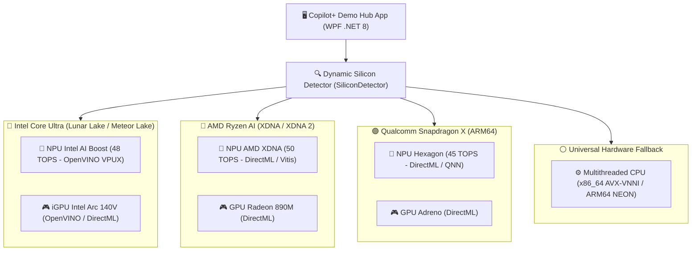
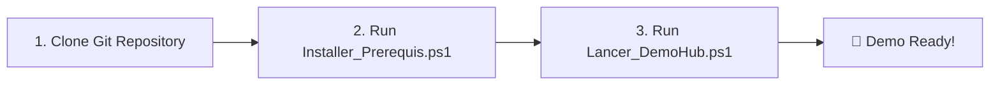

# 🚀 Copilot+ PC Demo Hub — Universal Multi-OEM AI Suite

🌐 **Language / Langue** : **[ 🇬🇧 English Version (Active) ](README.md)** | **[ 🇫🇷 Version Française ](README.fr.md)**  
📖 **Installation Guide** : **[ 🇬🇧 Installation Guide (EN) ](INSTALLATION_GUIDE.md)** | **[ 🇫🇷 Guide d'Installation (FR) ](GUIDE_INSTALLATION.md)**

[](https://microsoft.com)
[](https://dotnet.microsoft.com)
[](https://python.org)
[]()
[]()
[]()
[]()

A comprehensive software showcase of **100% local, private, and sovereign Artificial Intelligence**, universally compatible across the entire **Copilot+ PC** hardware ecosystem:
- 🔵 **Intel Core Ultra (Lunar Lake & Meteor Lake)** via **Intel AI Boost (48 TOPS)** & Arc iGPU.
- 🔴 **AMD Ryzen AI 300 Series (Strix Point)** via **AMD XDNA 2 (50 TOPS)** & Radeon GPU.
- 🟣 **Qualcomm Snapdragon X Elite / Plus** via **Qualcomm Hexagon (45 TOPS)** & Adreno GPU.
- ⚪ **Automatic Universal Fallback** on DirectX 12 GPU (DirectML) and multi-threaded CPU (AVX-512 / ARM64).

---

## 🏗️ Universal Silicon Architecture & Auto-Detection

The **Copilot+ Demo Hub** embeds a real-time hardware auto-detection engine (`SiliconDetector.cs`) that continuously analyzes the host CPU, GPU, and neural co-processors (NPU) to dynamically select the most power-efficient AI runtime:



---

## 🌟 Enterprise & Engineering Demo Catalog

### 1. 🏢 Business & Industry AI Assistant (Local Phi-4 LLM)
- **Model**: `Phi-4-mini-instruct` (Microsoft Foundry Local & OpenVINO / DirectML).
- **Silicon Acceleration**: Natively compiled for the detected NPU (**Intel AI Boost**, **AMD Ryzen AI**, or **Qualcomm Hexagon**), with graceful fallback to DirectML GPU then host CPU.
- **4-Stage Reasoning Pipeline**: Dynamic real-time chain-of-thought (`1. Contextual Analysis`, `2. Regulatory Verification`, `3. Operational Synthesis`, `4. Actionable Recommendations`).
- **Live Telemetry**: 75ms timer, real-time throughput gauge (`tok/s`), generated token counter, and live SoC load monitoring.
- **4 Built-in Industry Personas**:
  - **Financial Services**: Corporate solvency audit and business credit risk scoring.
  - **Industrial Operations**: Predictive HVAC failure diagnostic and emergency intervention criticality.
  - **Engineering & R&D**: Electro-mechanical troubleshooting and safety override protocols.
  - **Automotive Claims**: Joint repair quote & accident liability report assessment.

---

### 2. 🪄 Magic Eraser Studio (Instant Semantic Segmentation & Inpainting)
- **Model**: `YOLOv8n-Seg` (OpenVINO IR, ONNX DirectML, or Microsoft Olive FP16).
- **Silicon Acceleration**: Execution on **Copilot+ NPU (Intel / AMD / Qualcomm)** or DirectML GPU.
- **Resident IPC Daemon Architecture**: Pre-warmed background worker cutting detection latency from **4,500 ms down to only 84 ms (53x speedup)**.
- **Capabilities**: Pixel-accurate instance segmentation masks for unwanted objects and people, paired with high-fidelity context-aware inpainting that preserves backgrounds.

---

### 3. 🛡️ Zero-Trust Physical Access Control (Real-Time Vision & Minesweeper)
- **Model**: `YOLOv8s-World` open-vocabulary zero-shot vision (OpenVINO IR, ONNX DirectML, or Microsoft Olive FP16).
- **Silicon Acceleration**: Runs on **NPU by default** (with real-time GPU/CPU switching and reporting of the actual `effective_device`).
- **Anti-Spoofing & Security**: Presentation attack detection (identifying smartphones/tablets held in front of the lens) with a built-in gallery of test samples.
- **Compliance Matrix**: 3-out-of-3 concurrent compliance check (Coffee Mug ☕, Eyeglasses 👓, Audio Headset 🎧) to unlock the executive workstation and reveal the sovereign Minesweeper game.

---

### 4. 🎙️ Audio Studio & Speaker Diarization (STT, Voice Biometrics & NPU Translation)
- **Pre-warmed NPU Whisper Daemon (`--daemon` + Blob Cache)**: `Whisper-Tiny`, `Whisper-Base` (INT8 NPU), and `Whisper-Small` maintained warm in NPU memory upon tab selection (**`8 ms`** click latency, **`1.48 s`** total to transcribe and diarize 25 s of audio).
- **Bilingual FR / EN & Real-Time Recovery (`lang_utils.py`)**: Automatic language identification turn-by-turn with **on-the-fly NPU auto-correction** (`smart_transcribe_turn`) if Whisper in `Auto` mode drifts towards English during short French statements.
- **1-Click Full Translation (`🌐 → 🇫🇷 French` / `🌐 → 🇬🇧 English`)**: Injects a complete translated transcript card streamed from the **NPU (`phi-4-mini-instruct-openvino-npu`)**, preserving speaker labels `[Speaker] : ...`, along with on-the-fly turn translation.
- **Speaker Biometrics & TPM 2.0 Security**: `VoxCeleb ECAPA-TDNN ONNX` neural network extracting cryptographic voiceprints sealed with DPAPI / TPM hardware keys, coupled with true live power telemetry (`HardwareTelemetryService`).

---

### 5. 📄 Sovereign PDF Studio, Intelligent OCR & Legal NPU Audit
- **Hybrid Vector Engine & Neural OCR**: High-performance `PyMuPDF` paired with `RapidOCR` accelerated on **NPU / GPU DirectML** for scanned invoices and receipts.
- **Semantic Legal & GDPR Audit on NPU (`Phi-4-mini`)**: Local streaming analysis (`phi-4-mini-instruct-openvino-npu`) producing an executive summary, high-risk clause identification, and contextual PII extraction (names, company IDs, addresses) invisible to static Regex.
- **1-Click Hybrid AI + GDPR Redaction (`--mode ai_audit`)**: Combines LLM-detected entities with standard GDPR patterns (IBAN with spaces, European tax IDs, phone numbers, emails, financial amounts) to permanently redact the PDF with zero traces under black boxes, displaying certified energy consumption in Watts and Joules.

---

### 6. 🎨 Avatar Studio (Image-to-Image Generation & Diffusion)
- **Model**: `LCM DreamShaper v7` quantized to 8-bit (Latent Consistency Model).
- **Silicon Acceleration**: **Copilot+ NPU** and **DirectML GPU**.
- **Performance**: Stylized photorealistic avatar generation (3D Cartoon / Pixar, Anime, Cyberpunk, 1960s Vintage) in just 4 to 8 inference steps (~3 seconds).

---

### 7. ⚡ Silicon Duel & Hardware Power Benchmark
- **Hardware Telemetry**: Real-time measurement of battery power draw (Watts), SoC frequency, and thermal curves.
- **Tri-State Comparative Duel**: Visual benchmark proving the energy efficiency of the **Copilot+ NPU (40 to 50+ TOPS)** versus native GPU and Microsoft Olive optimized variants.

---

### 8. 🧪 Microsoft Olive Optimization Lab & MCP Multi-Agent Trio
- **Scientific Test Bench**: Real-time head-to-head duel between raw FP32 models and Microsoft Olive compiled graphs (FP16 / operator fusion) across Vision, Segmentation, and OCR.
- **Measured Gains**: 50% RAM and SSD reduction, +40% to +80% latency speedup, and significant battery Joules savings while maintaining 100% output fidelity.
- **MCP Multi-Agent Trio**: 3 autonomous AI agents concurrently invoking neural tools via a local JSON-RPC 2.0 Model Context Protocol (MCP) server.

---

### 9. 📊 Enterprise Governance & Fleet Audit Console
- **CIO & CISO Supervision**: Centralized dashboard for IT executives and security officers.
- **Traceability & Compliance**: Local audit ledger logging every inference (model executed, silicon co-processor utilized, P50/P90 latencies, Zero-Trust compliance).
- **Carbon Footprint & Green IT**: Automated calculation of saved kWh and avoided CO2 emissions compared to cloud hyperscaler API calls.

---

### 10. 🩺 Healthcare AI Landscape (General SLM, Domain SLM, Clinical NLU & Medical Agent)
- **Sovereign Clinical Copilot Showcase**: High-impact demonstration illustrating the absolute privacy and security of on-device healthcare AI (100% HIPAA / GDPR / HDS compliant, zero cloud leaks).
- **The 4 Paradigms Compared on an Authentic Case** (Mr. Robert, 64 yrs, lower back pain under daily Kardegic / Aspirin):
  1. 🟣 **Generalist SLM (Raw)**: Basic public health advice. Dangerously suggests Ibuprofen without verifying patient history.
  2. 🔵 **Domain SLM (Vidal & ANSM)**: Certified pharmacology specialist revealing the level-4 lethal contraindication (NSAID + Aspirin = upper GI hemorrhage).
  3. 🟢 **Clinical NLU (Context & Omissions)**: Understands the full consultation context and pinpoints practitioner omissions (unrequested Carte Vitale, missing blood pressure).
  4. 🟠 **Active Medical Agent**: Dual-mode execution (**👣 Interactive Step-by-Step** with action buttons & **🩺 Ambient Real Doctor** for live consultations). Blocks the dangerous prescription, substitutes Paracetamol, generates the official SESAM-Vitale claim (€26.50), and cryptographically seals the local health record (DMP).
- **Clinical Decision Matrix**: Compares output consumers, contextual understanding, pharmacological safety, and autonomous execution capabilities.

---

## ⚡ Step-by-Step Deployment Guide

Designed for **1-click automated deployment with zero manual configuration**.



### Step 1: Clone the Git Repository
Open a **PowerShell** terminal:
```powershell
git clone https://github.com/JuGhithub/CopilotPlusDemoHub.git
cd CopilotPlusDemoHub
```

### Step 2: Run the Automated Installer
In PowerShell, run:
```powershell
.\Installer_Prerequis.ps1
```
*(Or double-click `Installer_Prerequis.bat` in Windows Explorer)*

The installer automatically handles everything sequentially:
1. ✅ **Enables Windows Long Paths** (`LongPathsEnabled`) for PyTorch and OpenVINO.
2. ✅ **Installs system runtimes**: **.NET 8.0 SDK** and **Python 3.12** via `winget`.
3. ✅ **Installs Python AI libraries** listed in `requirements.txt`.
4. ✅ **Installs Microsoft Foundry Local CLI** and downloads **Phi-4-mini** models (NPU, GPU, CPU).
5. ✅ **Automatically downloads 100% of local AI models** (`models/`) via [`scripts/download_models.py`](scripts/download_models.py): Whisper Tiny/Base, VoxCeleb Biometrics, YOLOv8s-World Vision, YOLOv8n-Seg Segmentation, and Avatar LCM DreamShaper.
6. ✅ **Compiles the WPF application** in high-performance Release mode.
7. ✅ **Runs automated health diagnostics** (`scripts/verify_installation.py`) across 39 verification points.

### Step 3: Launch the Showcase
In PowerShell:
```powershell
.\Lancer_DemoHub.ps1
```
*(Or double-click `Lancer_DemoHub.bat`)*

---

## 📦 Alternative Distribution (Ready-to-Use Binary via GitHub Releases)

For team members who do not wish to install Git or compile code:
1. On the reference device, run `.\Creer_Package_Release.ps1` (or double-click `Creer_Package_Release.bat`) to build a standalone archive in `Releases/`.
2. Upload this ZIP archive to the **Releases** tab of your GitHub repository.
3. Users only need to download the ZIP, extract it, and execute `.\Lancer_DemoHub.ps1`.

---

## 💻 Hardware Requirements & Runtimes by OEM

| Manufacturer | Processor | Dedicated NPU (40+ TOPS) | GPU & Acceleration | Recommended Runtime |
| :--- | :--- | :--- | :--- | :--- |
| **Intel** | Core Ultra Series 2 (Lunar Lake 258V/268V/288V) or Series 1 | **Intel AI Boost (48 TOPS)** | Intel Arc Graphics (140V Xe2) | Native OpenVINO IR + DirectML |
| **AMD** | Ryzen AI 300 Series (e.g. AI 9 HX 370 / Strix Point) | **AMD Ryzen AI / XDNA 2 (50 TOPS)** | AMD Radeon 890M / 880M | DirectML + Olive FP16 |
| **Qualcomm** | Snapdragon X Elite / Plus (X1E-80, X1P) | **Qualcomm Hexagon (45 TOPS)** | Qualcomm Adreno GPU | DirectML / QNN + Olive FP16 |
| **Universal** | Any Windows 11 PC with 64-bit CPU | Software CPU Emulation | DirectX 12 GPU (DirectML) | CPU AVX / ARM64 Fallback |

- **RAM**: 32 GB LPDDR5X recommended (16 GB minimum).
- **Storage**: Fast NVMe SSD with 15 to 20 GB free space for local neural model weights.
- **OS**: **Windows 11 64-bit version 24H2 (Build 26100+)** required for the Copilot+ designation.

---

## 📁 Repository Structure

```text
├── DemoHub/                 # C# .NET 8 WPF application (Main window, Telemetry, Demo Views)
│   ├── Core/                # Hardware detection, Telemetry, Audio, and Foundry Local client
│   ├── Demos/               # Industry logic handlers (Finance, Operations, Engineering, Insurance)
│   └── UI/Views/            # XAML UI layouts and Code-Behind logic
├── Data/                    # Test assets (Documents, Sample audio, Claim photos, Badges)
├── Config/ & Prompts/       # Business prompts and inference configurations
├── scripts/                 # Automation and diagnostic scripts
│   ├── download_models.py   # Automated download and export of all local AI models
│   ├── verify_installation.py # Full 39-point diagnostic and environment audit
│   ├── creer_package_release.ps1 # Packaging script for standalone GitHub Releases
│   └── optimize_with_olive.py # Microsoft Olive optimization pipeline
├── *.py                     # Standalone Python microservices (Vision, Eraser, Whisper, Speaker, OCR, Avatar)
├── Installer_Prerequis.ps1  # 1-click PowerShell installer (Winget + Pip + Models + Build)
├── Lancer_DemoHub.ps1       # PowerShell launcher with NPU/GPU hardware pre-warming
├── Compiler_DemoHub.ps1     # PowerShell build script (.NET 8 Release)
├── Creer_Package_Release.ps1# Standalone release zip packager
├── *.bat                    # Double-click batch wrappers for non-technical users
├── requirements.txt         # Python dependencies (OpenVINO, PyTorch, PyMuPDF, Ultralytics, etc.)
├── INSTALLATION_GUIDE.md    # Complete technical installation and troubleshooting guide in English
├── GUIDE_INSTALLATION.md    # Guide d'installation complet en Français
├── README.fr.md             # Documentation complète en Français
└── README.md                # This complete English documentation
```

---

## 🛠️ Common Troubleshooting

1. **Windows Long Paths (`LongPathsEnabled`)**:
   - If PyTorch or pip reports path length errors, run PowerShell as Administrator:
     `Set-ItemProperty -Path "HKLM:\SYSTEM\CurrentControlSet\Control\FileSystem" -Name "LongPathsEnabled" -Value 1`
2. **NPU Not Detected (0% usage in Task Manager)**:
   - Ensure the latest Intel NPU driver is installed via the [Intel Driver & Support Assistant](https://www.intel.com/content/www/us/en/support/detect.html).
3. **Webcam Unavailable in Access Control**:
   - Check *Windows Settings > Privacy & security > Camera* to verify desktop application access is enabled.
4. **Avatar Studio Error (Code 1)**:
   - The LCM diffusion model is not downloaded yet. Run: `python scripts\download_models.py`.
5. **System-wide Health Audit**:
   - Execute `python scripts\verify_installation.py` at any time for an instant diagnostic report.

---

## 🔒 Privacy & Data Sovereignty

All AI inferences (LLM reasoning, computer vision, speech transcription, voice biometrics, and semantic segmentation) execute **strictly on local on-device silicon**. **Zero telemetry, documents, photos, or audio streams ever leave your device or transit through the cloud.**
