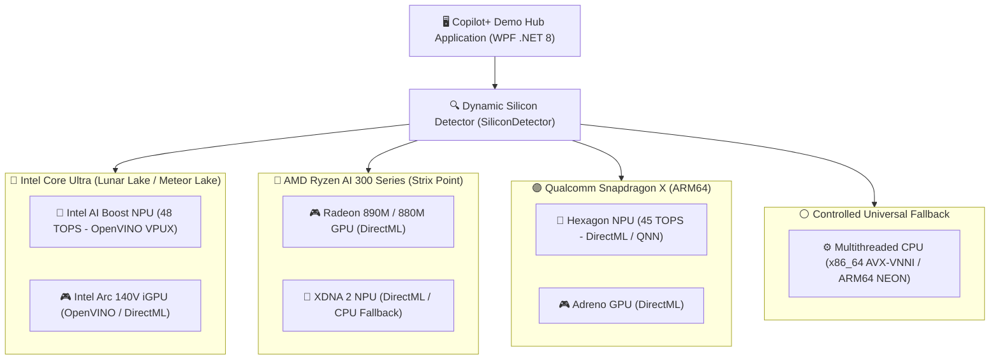
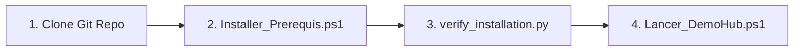

# 🚀 Copilot+ PC Demo Hub — Multi-Silicon Evaluation & Showcase Suite

🌐 **Language / Langue** : **[ 🇬🇧 English Version (Active) ](README.md)** | **[ 🇫🇷 Version Française ](README.fr.md)**  
📖 **Installation Guides** : **[ 🇬🇧 Installation Guide (EN) ](INSTALLATION_GUIDE.md)** | **[ 🇫🇷 Guide d'Installation (FR) ](GUIDE_INSTALLATION.md)**

[](https://microsoft.com)
[](https://dotnet.microsoft.com)
[-3776AB?logo=python)](https://python.org)
[]()
[]()
[]()

A modular technical showcase designed for **local on-device AI execution on Copilot+ PCs**, following the initial setup and model download, with transparent reporting of the active silicon accelerator:
- 🔵 **Intel Core Ultra Series 2 (Lunar Lake) & Series 1 (Meteor Lake)** *(Reference Platform)*: Optimized inference on the **Intel AI Boost NPU (48 TOPS)** and Arc 140V iGPU (native OpenVINO IR & DirectML) with active device verification.
- 🔴 **AMD Ryzen AI 300 Series (Strix Point)** *(Hybrid Mode)*: High-throughput inference on Radeon GPU via DirectML and AVX-512 host CPU.
- 🟣 **Qualcomm Snapdragon X Elite / Plus (ARM64)** *(Hybrid Mode / win-arm64 native binary)*: Inference on Adreno GPU via DirectML and ARM64 NEON CPU.
- ⚪ **Controlled Automatic Fallback**: Transparent and reported rerouting to DirectX 12 GPU (DirectML) then host CPU with immediate telemetry logging.

---

## 📊 Platform Validation & Hardware Support Matrix

| Platform | Validation Status | Primary Accelerator | Recommended Runtime |
| :--- | :--- | :--- | :--- |
| **Intel Core Ultra Series 2** (Lunar Lake 258V/268V/288V) | **Validated & Optimized** | Intel AI Boost NPU (48 TOPS) + Arc 140V GPU | Native OpenVINO IR (100% NPU) + DirectML |
| **Intel Core Ultra Series 1** (Meteor Lake / Arrow Lake) | **Compatible** (pending drivers) | Intel AI Boost NPU (11 TOPS) + Arc GPU | OpenVINO IR + DirectML |
| **AMD Ryzen AI 300 Series** (Strix Point) | **Experimental** (hybrid mode) | AMD Radeon 890M / 880M GPU | ONNX DirectML + Olive FP16 / Host CPU |
| **Qualcomm Snapdragon X** (ARM64) | **Experimental** (hybrid mode) | Qualcomm Adreno GPU | ONNX DirectML + native win-arm64 binary |
| **Standard Windows 11 PC (No NPU)** | **Degraded Mode** | DirectX 12 GPU / Host CPU | AVX-512 CPU Fallback / DirectML |

---

## 🏗️ Silicon Architecture & Dynamic Detection

**Copilot+ Demo Hub** embeds dynamic hardware discovery ([`SiliconDetector.cs`](DemoHub/Core/SiliconDetector.cs)) which analyzes CPU, GPU, and NPU availability to route to the most optimal on-device runtime:



---

## 🌟 Showcase Catalogue

### 1. 🏢 Business & Enterprise Copilot (Local SLM Phi-4)
- **Model**: `Phi-4-mini-instruct` (Microsoft Foundry Local & OpenVINO / DirectML).
- **Acceleration**: Optimized for NPU when available (**Intel AI Boost**, **AMD Ryzen AI**, or **Qualcomm Hexagon**), with automatic fallback to DirectML GPU and host CPU.
- **4-Stage Reasoning Pipeline**: Dynamic chain-of-thought (`1. Context analysis`, `2. Regulatory check`, `3. Operational synthesis`, `4. Recommendations`).
- **Live Telemetry**: Real-time generation speed (`tok/s`), token counter, and system utilization.
- **4 Integrated Enterprise Personas**: Financial Services (credit risk), Industrial Operations (predictive HVAC maintenance), Engineering & R&D (electromechanical diagnostics), and Auto Insurance Claims (repair assessment).

---

### 2. 🪄 Magic Eraser Studio (Instant Semantic Segmentation)
- **Model**: `YOLOv8n-Seg` (OpenVINO IR, ONNX DirectML, or Microsoft Olive FP16).
- **Acceleration**: Accelerated on **Intel AI Boost NPU** or DirectML GPU.
- **Resident IPC Daemon**: Pre-warmed background worker reducing detection latency from **4,500 ms down to 84 ms (53x speedup)**.
- **Capabilities**: Object and person segmentation, pixel-accurate mask generation, and inpainting background reconstruction.

---

### 3. 🛡️ Zero-Trust Access Control (Real-Time Computer Vision)
- **Model**: `YOLOv8s-World` (OpenVINO IR, ONNX DirectML, or Microsoft Olive FP16).
- **Acceleration**: Default NPU execution with dynamic fallback and transparent silicon reporting.
- **Anti-Spoofing Security**: Presentation attack detection (mobile phone or printed photo presented to the camera) with test galleries.
- **3/3 Compliance Matrix**: Simultaneous detection (Mug ☕, Eyeglasses 👓, Headphones 🎧) to unlock the executive console.

---

### 4. 🎙️ Audio Studio & Speakers (STT, Diarization & Biometrics)
- **Pre-warmed Whisper NPU Models**: `Whisper-Tiny` and `Whisper-Base` (OpenVINO IR) held in memory for immediate response.
- **Bilingual FR / EN & Live Correction (`lang_utils.py`)**: Automatic language identification and repetition filter preventing acoustic hallucination loops.
- **Assisted Translation**: On-device translated summary cards generated via `phi-4-mini-instruct-openvino-npu` preserving speaker labels.
- **Encrypted Biometric Profiles**: `VoxCeleb ECAPA-TDNN ONNX` neural embeddings **locally encrypted using Windows DPAPI** (tied to current active Windows user session).

---

### 5. 📄 PDF Studio, OCR & Assisted Redaction
- **Vector Engine & Hybrid OCR**: `PyMuPDF` paired with `RapidOCR` leveraging **Intel AI Boost NPU & DirectML GPU Arc 140V**.
- **Local Semantic Analysis**: Executive summary and sensitive clauses extraction using `Phi-4-mini`.
- **Assisted Document Redaction**: Combined SLM and regex detection of personal confidential data (IBAN, tax IDs, phone numbers, emails, financial amounts) with permanent black-box redaction (human validation recommended prior to sharing).

---

### 6. 🎨 Avatar Studio (Image Diffusion & Generation)
- **Model**: 8-bit quantized `LCM DreamShaper v7` (Latent Consistency Model).
- **Acceleration**: **Copilot+ NPU** and **DirectML GPU**.
- **Performance**: Stylized image generation in 4 to 8 inference steps (~3 seconds).

---

### 7. ⚡ Silicon Duel & Hardware Power Benchmark
- **Estimated Telemetry**: Real-time estimation of power draw (Watts and Joules), frequency, and thermal curves from available hardware counters.
- **Tri-State Benchmark**: Comparative demonstration showing efficiency gains between native models, raw ONNX, and Microsoft Olive optimized variants.

---

### 8. 🧪 Microsoft Olive Optimization Lab & MCP Fleet
- **Scientific Benchmark**: Side-by-side evaluation between FP32 base models and Microsoft Olive compiled models (FP16 / operator fusion).
- **Multi-Agent Fleet**: 3 local autonomous agents executing neural tools in parallel through a Model Context Protocol (MCP) server conforming to JSON-RPC 2.0.

---

### 9. 📊 IT Governance & Fleet Telemetry Console
- **Enterprise Fleet Audit**: Centralized dashboard for IT and security leadership.
- **Audit Trails & Observability**: Local inference telemetry (executed model, silicon processor, measured P50/P90 latencies, fallback status).
- **Estimated Carbon Savings**: Estimated reduction in energy consumption compared to cloud data center processing.

---

### 10. 🩺 Healthcare AI Showcase (SLM, NLU & Active Medical Agent)
- **Demonstration Clinical Scenario**: Side-by-side didactic comparison of 4 AI paradigms on an on-device clinical case (zero medical data sent over the network).
- **Comparative Paradigms**: Generic SLM vs Medical SLM with pharmacovigilance knowledge vs Context NLU vs Active Medical Agent.

---

## ⚡ Deployment & Quickstart



### Quick Installation:
```powershell
# Automated setup (configures isolated .venv and installs requirements.lock)
.\Installer_Prerequis.ps1

# Launch the application
.\Lancer_DemoHub.ps1
```

For modular installation switches, manual instructions, or Snapdragon X (ARM64) builds, see the [Complete Installation Guide](INSTALLATION_GUIDE.md).

---

## 📁 Repository Structure

```text
├── DemoHub/                 # WPF C# .NET 8 host application (MVVM, Views, Controllers)
├── DemoHub.Tests/           # xUnit C# unit test project (ProcessRunner, telemetry, silicon detection)
├── tests/                   # Python pytest suite (DPAPI vault, anti-tamper, language filters)
├── .github/                 # GitHub CI & configuration (workflows/ci.yml, dependabot.yml)
├── Data/                    # Synthetic and royalty-free test datasets (see DATA_NOTICES.md)
├── Config/ & Prompts/       # Inference configurations and reasoning prompts
├── scripts/                 # Automation and diagnostic scripts
│   ├── download_models.py   # Model download, SHA-256 verification, and ONNX export
│   ├── verify_installation.py # Diagnostic script with Section 8 real hardware smoke tests
│   ├── creer_package_release.ps1 # Multi-architecture packager (win-x64 / win-arm64)
│   └── optimize_with_olive.py # Microsoft Olive optimization runner
├── *.py                     # Specialized Python micro-services (Vision, Eraser, Whisper, Speaker, OCR, Avatar)
├── requirements.lock        # Deterministic pinning of all 106 Python packages
├── requirements.txt         # Primary Python dependencies
├── MODEL_MANIFEST.json      # SHA-256 cryptographic registry and model metadata
├── SECURITY.md              # Security policy and vulnerability disclosure guidelines
├── THIRD_PARTY_NOTICES.md   # Open-source third-party licenses
├── DATA_NOTICES.md          # Synthetic sample data notices and transparency statement
├── GUIDE_INSTALLATION.md    # Installation guide in French
├── INSTALLATION_GUIDE.md    # Installation guide in English
├── README.fr.md             # Documentation in French
└── README.md                # Documentation in English
```

---

## 🔒 Privacy & Operational Scope

All neural inferences are engineered to run locally on the host device following the initial package and model setup. No user data is transmitted to third-party cloud infrastructure. Decision support and assisted document redaction are algorithmic aids requiring qualified human oversight.
