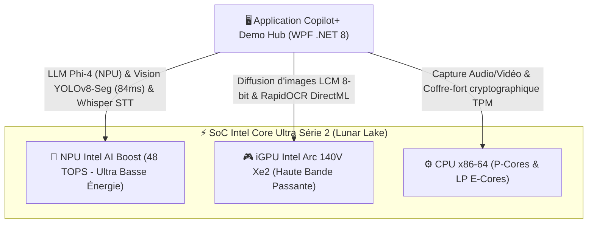
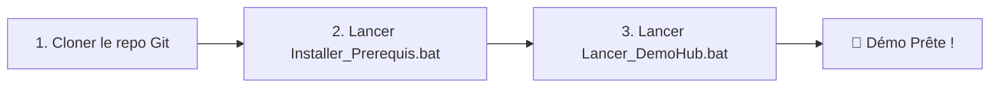

# 🚀 Copilot+ PC Demo Hub

[](https://microsoft.com)
[](https://dotnet.microsoft.com)
[](https://python.org)
[](https://intel.com)
[](https://intel.com)
[](https://openvino.ai)
[]()

Une suite complète d'expériences logicielles d'**Intelligence Artificielle 100% locales, privées et souveraines**, spécialement conçues pour exploiter au maximum le silicium des **PC Copilot+** équipés des processeurs **Intel Core Ultra Série 2 (Lunar Lake)** et de leur accélérateur neuronal **NPU Intel AI Boost (40 à 48 TOPS)**.

---

## 🏗️ Architecture Matérielle & Répartition Neuronale

Le **Copilot+ Demo Hub** répartit intelligemment les charges d'inférence en fonction des spécialisations matérielles du SoC :



---

## 🌟 Catalogue des Démonstrations Métiers

### 1. 🏢 Assistant Métier & Business (LLM Local Phi-4)
- **Modèle** : `Phi-4-mini-instruct` (Microsoft Foundry Local & OpenVINO GenAI).
- **Accélération** : Compilé nativement pour le **NPU Intel AI Boost** avec fallback iGPU Arc.
- **Pipeline de Raisonnement en 4 étapes** : Décomposition dynamique en temps réel (`1. Analyse contextuelle`, `2. Vérification réglementaire`, `3. Synthèse opérationnelle`, `4. Recommandations`).
- **Télémétrie en direct** : Chronomètre à 75ms, jauge de débit d'inférence en temps réel (`tok/s`), compteur de tokens générés et surveillance de la charge SoC.
- **4 Personas Métiers intégrés** :
  - **Services Financiers** : Audit de solvabilité et analyse de risques de crédit entreprise.
  - **Opérations Industrielles** : Diagnostic prédictif d'avarie sur groupe CVC et criticité d'intervention.
  - **Ingénierie & R&D** : Dépannage électromécanique et procédures de sécurité d'urgence.
  - **Sinistres Automobile** : Évaluation conjointe devis / constat d'accident.

---

### 2. 🪄 Gomme Magique Studio (Segmentation Sémantique Instantanée)
- **Modèle** : `YOLOv8n-Seg` OpenVINO IR.
- **Accélération** : Inférence 100% sur **NPU Intel AI Boost**.
- **Architecture Daemon IPC Résident** : Travailleur d'arrière-plan préchargé réduisant la latence de détection de **4 500 ms à seulement 84 ms (accélération x53)**.
- **Fonctionnalités** : Détection automatique des personnes et objets gênants, masque de segmentation précis au pixel près, et inpainting haute fidélité sans altérer le fond.

---

### 3. 🛡️ Contrôle d'Accès Zero-Trust (Vision par Ordinateur Temps Réel)
- **Modèle** : `YOLOv8s-World` OpenVINO IR (Détection ouverte Zero-Shot).
- **Accélération** : Pipeline hybride **NPU / GPU**.
- **Flux Vidéo** : Capture webcam fluide à 30 IPS.
- **Matrice de Conformité de Sécurité** : Détection simultanée et sans entraînement préalable de badges professionnels, casques de chantier, lunettes de protection et tasses/objets interdits dans les zones sécurisées.

---

### 4. 🎙️ Audio Studio & Locuteurs (STT & Biométrie Vocale)
- **Transcription** : Modèles `Whisper-Tiny` et `Whisper-Base` quantifiés FP16 OpenVINO pour une retranscription vocale ultra-rapide en français et en anglais.
- **Biométrie du Locuteur** : Réseau neuronal profond `VoxCeleb ECAPA-TDNN ONNX` extrayant l'empreinte acoustique unique de chaque participant.
- **Sécurité TPM 2.0** : Scellement cryptographique des profils biométriques dans le matériel Windows via DPAPI / TPM.

---

### 5. 📄 PDF Studio & OCR Intelligent
- **Moteur Vectoriel** : `PyMuPDF` haute performance pour l'extraction de texte et la manipulation de structures PDF.
- **OCR Neuronal Hybride** : `RapidOCR` accéléré par **DirectML / GPU** pour les scans et documents numérisés dégradés.
- **Anonymisation & Conformité RGPD** : Détection et caviardage automatique des données sensibles (IBAN, numéros de sécurité sociale, noms, montants).

---

### 6. 🎨 Studio Avatar (Génération & Diffusion d'Images)
- **Modèle** : `LCM DreamShaper v7` quantifié en 8-bit OpenVINO (Latent Consistency Model).
- **Accélération** : **NPU Intel AI Boost** et **iGPU Arc**.
- **Performance** : Génération d'images photoréalistes et stylisées (Pixar, Cyberpunk, Rétro) en seulement 4 à 8 étapes d'inférence (~3 secondes).

---

### 7. ⚡ Benchmark Énergétique & Hardware
- **Télémétrie Matérielle** : Mesure en temps réel de la consommation énergétique (Watts), de la fréquence et de la température.
- **Duel Comparatif** : Démonstration visuelle de l'efficience énergétique du **NPU Intel AI Boost (48 TOPS)** face à l'iGPU et au CPU classique.

---

## ⚡ Guide Pas à Pas pour vos Collègues

Le projet est conçu pour être déployé en **1 clic sans aucune configuration manuelle**.



### Étape 1 : Cloner le dépôt Git
Ouvrez un terminal **PowerShell** :
```powershell
git clone https://github.com/<VOTRE_ORGANISATION_OU_PSEUDO>/CopilotPlusDemoHub.git
cd CopilotPlusDemoHub
```

### Étape 2 : Lancer l'Installateur Automatique
Faites un clic droit sur [`Installer_Prerequis.bat`](Installer_Prerequis.bat) > **Exécuter en tant qu'administrateur** (ou double-clic).

Le script prend tout en charge automatiquement et séquentiellement :
1. ✅ **Activation des chemins longs Windows** (`LongPathsEnabled`) pour PyTorch et OpenVINO.
2. ✅ **Installation des socles système** : SDK **.NET 8.0** et **Python 3.12** via `winget`.
3. ✅ **Installation des bibliothèques Python d'IA** listées dans `requirements.txt`.
4. ✅ **Installation de Microsoft Foundry Local CLI** et téléchargement des modèles **Phi-4-mini** (NPU, GPU, CPU).
5. ✅ **Téléchargement automatique de 100% des modèles d'IA locaux** (`models/`) via [`scripts/download_models.py`](scripts/download_models.py) : Whisper Tiny/Base, Biométrie VoxCeleb, Vision YOLOv8s-World, Segmentation YOLOv8n-Seg et Studio Avatar LCM.
6. ✅ **Compilation de l'application WPF** en mode Release haute performance.
7. ✅ **Diagnostic de santé automatique** (`scripts/verify_installation.py`) validant les 39 points de contrôle.

### Étape 3 : Lancer la Démonstration
Double-cliquez sur [`Lancer_DemoHub.bat`](Lancer_DemoHub.bat) pour lancer l'application avec préchauffage matériel instantané.

---

## 📦 Distribution Alternative (Binaire "Prêt à l'emploi" via GitHub Releases)

Pour les collègues qui ne souhaitent pas installer Git ni compiler le code :
1. Sur la machine de référence, lancez [`Creer_Package_Release.bat`](Creer_Package_Release.bat) pour créer une archive autonome dans `Releases/`.
2. Déposez cette archive dans l'onglet **Releases** de votre dépôt GitHub.
3. Vos collègues n'ont qu'à télécharger l'archive ZIP, la décompresser et double-cliquer sur `Lancer_DemoHub.bat`.

---

## 💻 Configuration Matérielle & Logicielle

| Composant | Recommandé (Copilot+ PC) | Minimal |
| :--- | :--- | :--- |
| **Processeur** | **Intel Core Ultra Série 2 (Lunar Lake : 258V, 268V, 288V)** | Intel Core Ultra Série 1 (Meteor Lake) |
| **NPU** | **Intel AI Boost (40 à 48 TOPS)** | NPU >= 40 TOPS |
| **GPU** | Intel Arc Graphics (140V Xe2 intégrée) | GPU compatible DirectX 12 / DirectML |
| **RAM** | **32 Go LPDDR5X** | 16 Go |
| **Stockage** | SSD NVMe avec 20 Go libres | SSD avec 15 Go libres |
| **Système** | **Windows 11 64-bit 24H2 (Build 26100+)** | Windows 11 23H2 |
| **Pilotes** | Intel NPU Compute Driver (VPUX 32.0+) & Pilote graphique Intel Arc à jour | Pilotes constructeur |

---

## 📁 Structure du Répertoire

```text
├── DemoHub/                 # Application WPF C# .NET 8 (Interface principale, Télémétrie, Démos)
│   ├── Core/                # Services de télémétrie, audio, détection de matériel et client Foundry
│   ├── Demos/               # Logique des démos métiers (Finance, Opérations, Ingénierie, Assurance)
│   └── UI/Views/            # Vues XAML et Code-Behind de chaque studio
├── Data/                    # Échantillons de test (Documents, Audios, Photos de sinistres et badges)
├── Config/ & Prompts/       # Prompts de raisonnement métier et configurations d'inférence
├── scripts/                 # Scripts d'automatisation
│   ├── download_models.py   # Téléchargement et export automatique de tous les modèles d'IA
│   ├── verify_installation.py # Diagnostic complet de santé (39 vérifications matérielles & logicielles)
│   ├── creer_package_release.ps1 # Empaqueteur pour GitHub Releases
│   └── optimize_with_olive.py # Script d'optimisation Microsoft Olive
├── *.py                     # Microservices Python autonomes (Vision, Eraser, Whisper, Speaker, OCR, Avatar)
├── Installer_Prerequis.bat  # Script d'installation automatisée en 1 clic (Winget + Pip + Modèles)
├── Lancer_DemoHub.bat       # Script de lancement avec préchauffage matériel NPU/GPU
├── Compiler_DemoHub.bat     # Script de compilation .NET 8
├── Creer_Package_Release.bat# Générateur d'archive zip pour distribution
├── requirements.txt         # Dépendances Python (OpenVINO, PyTorch, PyMuPDF, Ultralytics, etc.)
├── GUIDE_INSTALLATION.md    # Manuel technique exhaustif et résolution des incidents
└── README.md                # Cette documentation
```

---

## 🛠️ Résolution des Incidents Fréquents

1. **Chemins longs Windows (`LongPathsEnabled`)** :
   - Si PyTorch signale une erreur de chemin tronqué, lancez PowerShell en tant qu'administrateur :
     `Set-ItemProperty -Path "HKLM:\SYSTEM\CurrentControlSet\Control\FileSystem" -Name "LongPathsEnabled" -Value 1`
2. **NPU non détecté (0% dans le Gestionnaire des tâches)** :
   - Mettez à jour le pilote Intel NPU via l'[Assistant Pilotes Intel](https://www.intel.fr/content/www/fr/fr/support/detect.html).
3. **Webcam indisponible dans le Contrôle d'Accès** :
   - Vérifiez dans *Paramètres Windows > Confidentialité et sécurité > Caméra* que l'accès aux applications de bureau est activé.
4. **Diagnostic global** :
   - Exécutez `python scripts\verify_installation.py` à tout moment pour obtenir un rapport d'intégrité complet.

---

## 🔒 Confidentialité & Souveraineté des Données

Toutes les inférences d'IA (LLM, vision par ordinateur, transcription audio, biométrie vocale et segmentation) s'exécutent **exclusivement sur les puces locales de la machine**. **Aucune donnée, image, document ou flux audio ne transite par le cloud.**
