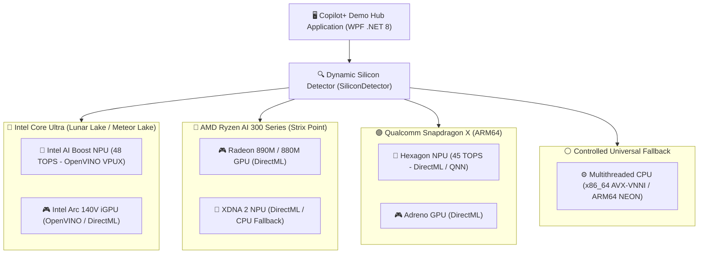
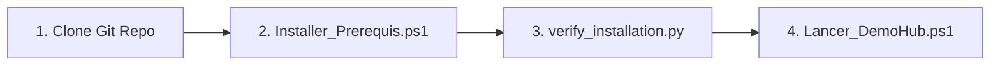

# 🚀 Copilot+ PC Demo Hub — Multi-Silicon Evaluation & Showcase Suite

🌐 **Language / Langue** : **[ 🇬🇧 English Version (Active) ](README.md)** | **[ 🇫🇷 Version Française ](README.fr.md)**  
📖 **Installation Guides** : **[ 🇬🇧 Installation Guide (EN) ](INSTALLATION_GUIDE.md)** | **[ 🇫🇷 Guide d'Installation (FR) ](GUIDE_INSTALLATION.md)**

[](https://microsoft.com)
[](https://dotnet.microsoft.com)
[-3776AB?logo=python)](https://python.org)
[]()
[](.github/workflows/ci.yml)
[](DemoHub.Tests/)
[](tests/)
[](.github/workflows/codeql.yml)
[](requirements.lock)
[](MODEL_MANIFEST.json)
[](SBOM.spdx.json)

**Copilot+ Demo Hub** is an advanced, structured technical showcase and evaluation suite designed for **100% on-device AI execution on Windows 11 Copilot+ PCs** (following initial setup and model download). It provides full observability into hardware acceleration, latency, and power efficiency across heterogeneous neural processors (NPUs, GPUs, and CPUs).

> [!IMPORTANT]
> **Project Scope & Transparency**: This project is an engineering evaluation showcase. A strict technical boundary is maintained between:
> - **Real-world Physical Measurements**: Model inference latencies (P50/P90), ACPI battery discharge watts, and cryptographic SHA-256 model verification.
> - **Pedagogical Demonstrations**: Scripted simulation scenarios (e.g. SLM didactic duels, visual peripheral compliance) clearly marked with disclaimers to prevent simulated metrics from entering real telemetry logs.

---

## 📊 Platform Validation & Hardware Support Matrix

| Platform | Validation Status | Primary Accelerator | Recommended Runtime |
| :--- | :--- | :--- | :--- |
| **Intel Core Ultra Series 2** (Lunar Lake 258V/268V/288V) | **Validated & Optimized** *(Reference)* | Intel AI Boost NPU (48 TOPS) + Arc 140V GPU | OpenVINO IR validated on Intel NPU + DirectML |
| **Intel Core Ultra Series 1** (Meteor Lake 155H/165H) | **Compatible** (pending drivers) | Intel AI Boost NPU (11 TOPS) + Arc GPU | OpenVINO IR + DirectML |
| **Intel Core Ultra 200S / Arrow Lake** | **Compatible CPU/GPU** | Intel Arc GPU / Host CPU | DirectML + OpenVINO CPU |
| **AMD Ryzen AI 300 Series** (Strix Point) | **Experimental** (hybrid mode) | AMD Radeon 890M / 880M GPU | ONNX DirectML + Olive FP16 / Host CPU |
| **Qualcomm Snapdragon X** (ARM64) | **Experimental** (hybrid mode) | Qualcomm Adreno GPU / Hexagon NPU | ONNX DirectML + native `win-arm64` binary |
| **Standard Windows 11 PC (No NPU)** | **Degraded Mode** | DirectX 12 GPU / Host CPU | AVX-512 CPU Fallback / DirectML |

---

## 🏗️ Silicon Architecture & Dynamic Detection

**Copilot+ Demo Hub** embeds dynamic hardware discovery ([`SiliconDetector.cs`](DemoHub/Core/SiliconDetector.cs)) which analyzes CPU, GPU, and NPU availability to route to the most optimal on-device runtime:



---

## 🏆 Core Validated Showcases (Parcours Phares)

These three end-to-end user journeys are verified, benchmarked, and operate without simulated shortcuts:

### 1. 🏢 Technical & Enterprise Document Assistant (Local SLM Phi-4)
- **Local Inference Engine**: Powered by `Phi-4-mini-instruct` via **Microsoft Foundry Local** CLI or native OpenVINO IR / DirectML. Zero cloud tokens or telemetry transmitted outside the PC.
- **4-Stage Reasoning Pipeline**: Dynamic chain-of-thought (`1. Context Analysis`, `2. Regulatory & Risk Check`, `3. Operational Synthesis`, `4. Actionable Recommendations`).
- **Live Hardware Telemetry**: Real-time generation speed (`tok/s`), token counting, and memory allocation.
- **4 Real Enterprise Domains**: Financial Credit Analysis, Industrial HVAC Predictive Maintenance, Electromechanical Engineering, and Insurance Claim Damage Assessment.
- **Resilient Streaming**: Non-blocking asynchronous event streaming with explicit detection and reporting of partial or interrupted responses.

### 2. 🎙️ Local Transcription & Speaker Diarization (Whisper NPU)
- **Pre-warmed Whisper Engine**: `Whisper-Tiny` and `Whisper-Base` (OpenVINO IR) loaded directly into NPU/iGPU memory for instant sub-second response.
- **Bilingual & Hallucination Filter (`lang_utils.py`)**: Automatic language detection (FR/EN) and linguistic repetition suppression preventing acoustic hallucination loops on silence or background noise.
- **Encrypted Local Biometrics**: Voice embeddings (`VoxCeleb ECAPA-TDNN ONNX`) **locally encrypted with Windows DPAPI** tied to the user's active Windows session.
- **Assisted Local Synthesis**: Multi-speaker meeting synthesis generated locally by Phi-4 with speaker attribution preserved.

### 3. 📄 Neural OCR & Dynamic Sensitive Document Redaction
- **Hybrid OCR Pipeline**: High-speed text layout extraction via `PyMuPDF` paired with `RapidOCR` accelerated on **NPU** and **DirectML GPU**.
- **Automatic Scanned PDF Processing**: Detects scanned documents or images without native digital text layers and executes OCR dynamically before analysis.
- **Dynamic PII Detection & Destructive Redaction**: Combined regex and SLM identification of sensitive data (IBAN, tax IDs, phone numbers, emails, addresses, financial figures). Applies irreversible vector redaction annotations directly to the PDF file (no hardcoded sample names).

---

## 🎓 Pedagogical Demonstrations & Didactic Scenarios

The following scenarios are designed for didactic illustration and feature explicit UI badges:

- **🛡️ Visual Peripheral & Compliance Check (`SecurityAccessView`)**: Webcam-based presence checks (glasses, headphones, badge, anti-spoofing). *Educational scenario — does not gate enterprise security credentials.*
- **🪄 Magic Eraser Studio (`YOLOv8n-Seg`)**: Real-time semantic segmentation and inpainting with a resident background daemon (latency down to 84 ms).
- **🎨 Avatar Studio (`LCM DreamShaper v7`)**: Quantized 8-bit image diffusion in 4 to 8 steps (~3s). Telemetry measures real ACPI battery power discharge or marks metrics as `N/A`.
- **⚡ Silicon Duel & Microsoft Olive Optimization Lab**: Comparative benchmark illustrating efficiency gains across FP32, FP16, and Olive-optimized operator graphs.
- **📊 Local IT Governance & Telemetry Console**: Enterprise audit dashboard displaying genuine hardware latencies (P50/P90), active silicon accelerators, and estimated energy savings.

---

## ⚡ Deployment & Quickstart



### Quick Installation:
```powershell
# Automated setup (configures isolated .venv and selects appropriate architecture lock file)
.\Installer_Prerequis.ps1

# Launch the application with automatic hardware acceleration
.\Lancer_DemoHub.ps1
```

For modular switches (`-CheckOnly`, `-DownloadModels`, `-BuildApplication`) or Qualcomm Snapdragon X (ARM64) builds, see the [Installation Guide](INSTALLATION_GUIDE.md).

---

## 📁 Repository Structure

```text
├── DemoHub/                 # WPF C# .NET 8 host application (MVVM, Views, Controllers)
├── DemoHub.Tests/           # xUnit C# unit test project (ProcessRunner, telemetry, silicon detection)
├── tests/                   # Python pytest suite (DPAPI vault, anti-tamper, language filters)
├── .github/workflows/       # GitHub CI workflows (ci.yml, codeql.yml, dependabot.yml)
├── Data/                    # Synthetic and royalty-free test datasets (see DATA_NOTICES.md)
├── Config/ & Prompts/       # Inference configurations and reasoning prompts
├── demohub_common/          # Shared Python modules (devices, evidence, process management, OCR)
├── scripts/                 # Automation and diagnostic scripts
│   ├── download_models.py   # Model download, SHA-256 integrity verification, and ONNX export
│   ├── verify_installation.py # Diagnostic script with real hardware smoke tests
│   ├── creer_package_release.ps1 # Multi-architecture packager (win-x64 / win-arm64)
│   └── optimize_with_olive.py # Microsoft Olive optimization runner
├── requirements.lock        # Deterministic pinning of Python packages (UTF-8)
├── requirements-win-x64.lock # Pinned dependencies for Windows x64 (OpenVINO + DirectML)
├── requirements-win-arm64.lock # Pinned dependencies for Windows ARM64 (ONNX Runtime)
├── requirements.txt         # Environment requirements with architecture markers
├── MODEL_MANIFEST.json      # SHA-256 cryptographic registry and model metadata
├── SECURITY.md              # Security policy and vulnerability disclosure guidelines
├── THIRD_PARTY_NOTICES.md   # Open-source third-party licenses
├── DATA_NOTICES.md          # Synthetic sample data notices and transparency statement
├── GUIDE_INSTALLATION.md    # Installation guide in French
├── INSTALLATION_GUIDE.md    # Installation guide in English
├── README.fr.md             # Documentation in French
└── README.md                # Documentation in English
```

---

## 🔒 Privacy & Governance Statement

All neural inferences are engineered to run locally on the host device following the initial package and model setup. No customer or user data is transmitted to third-party cloud infrastructure. Algorithmic outputs (decision support, automated transcription, and assisted document redaction) are advisory aids requiring qualified human oversight.
